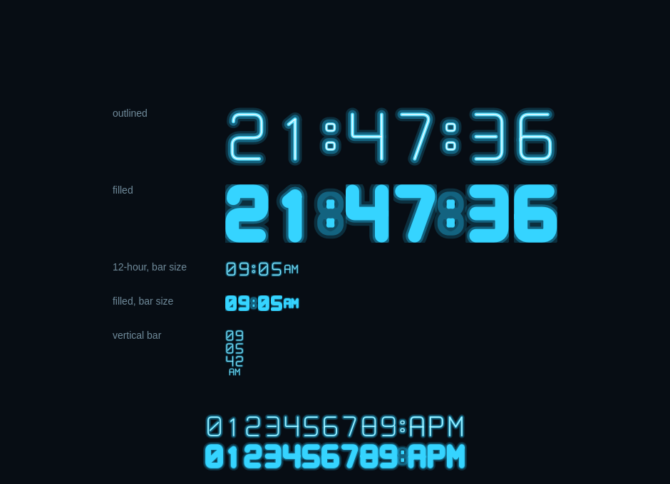

# Neon Clock

[](https://github.com/tcballard/omarchy-badges)

A standalone neon digital clock for the Omarchy bar. It does not replace the
built-in clock: both can be placed in the bar at the same time.



## Features

- Outlined or filled neon digits, switchable from the right-click panel.
- 24-hour or 12-hour display; 12-hour mode adds AM/PM.
- Optional seconds.
- Every changed digit rolls up: the new digit enters from below while the old
  one leaves above.
- Digits, colon and AM/PM scale to the bar and support horizontal and vertical
  bars.
- No font, package, network, or privileged setup; glyphs are vector paths.

## Controls

| Input | Action |
| --- | --- |
| Right click | Open the control panel (24-hour, seconds, filled digits). |
| Left click | Cycle between outlined and filled digits. |

Settings are stored inline on this plugin's entry in
`~/.config/omarchy/shell.json`:

```json
{
  "id": "io.github.kambiz.neon-clock",
  "use24Hour": true,
  "showSeconds": false,
  "digitStyle": "outlined"
}
```

## Requirements

- Omarchy 4 with Quattro shell-plugin support.
- No additional package, authentication, or privileged setup is required.

## Installation

```bash
omarchy plugin add https://github.com/kambiz/omarchy-neon-clock.git --enable
```

For a local checkout:

```bash
omarchy plugin add "$(pwd)" --enable
```

## Validation and tests

```bash
./tests/run
omarchy plugin validate .
```

`./tests/run` validates the manifest, runs the pure formatting and glyph tests
with Node when available, and lints the standalone QML. The preview harness is
separate:

```bash
./preview/run
```

It writes `preview/neon-clock-preview.png` using the offscreen Qt platform.

## Architecture

| File | Role |
| --- | --- |
| `BarWidget.qml` | Hosted bar entry: ticking, settings, click handling, popup lifecycle. |
| `NeonTime.qml` | Horizontal and vertical layout of digits, colon, and meridiem. |
| `NeonDigit.qml` | One clipped cell with the vertical roll animation. |
| `NeonGlyph.qml` | Neon renderer: glow, tube body, and hot centre. |
| `Glyphs.js` | Centre-line paths for `0`–`9`, `:`, `A`, `P`, `M`. |
| `ClockModel.js` | Time formatting, AM/PM, tick alignment, tooltip text. |
| `ControlPanel.qml` | Right-click `PopupCard` with the three toggles. |

The outlined and filled styles stroke the same centre-line skeleton at
different widths, so switching style does not change layout or animation
geometry.

## Update

```bash
omarchy plugin update io.github.kambiz.neon-clock
```

## Removal

```bash
omarchy plugin remove io.github.kambiz.neon-clock
```

The plugin stores no data outside normal Omarchy shell configuration.

## Security

Omarchy plugins run as unsandboxed code inside `omarchy-shell`. Review this
repository before enabling it. The plugin launches no processes and reads no
files.

## License

MIT © 2026 Kambiz
